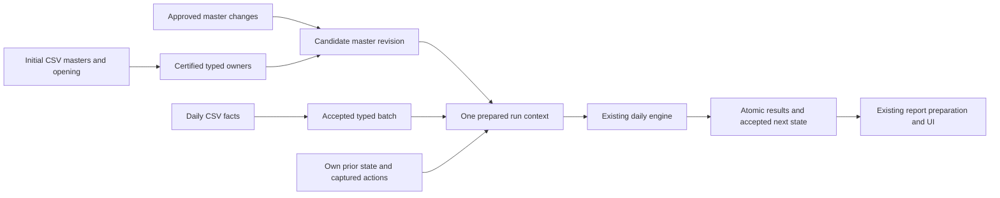

# Initialization, master ownership and daily intake — implementation plan

20 October 2026 · **Milestone 1 approved separately by the human. No automatic release of later milestones or the large-day trial.** Implementation evidence is in `INGESTION_MILESTONE1_HANDOFF.md`; live status remains in the sole tracker below.

Baseline: `687adcf024ea9bffe0c90b3de2bb67e25019ec4a`, branch `codex/3006-logistics-integration`. Source: `C:/Users/thapa/.codex/worktrees/handoff-3005/freshvcf`. The sole live status/approval/blocker tracker remains `F:/freshvcf/docs/handoff-3005/TRACKER.md`; this document is the specification, not another queue. This is one cohesive delivery with functional milestones, not separate approval programmes.

**DO NOT MODIFY FRONTEND CODE OR THE MTO STACK. Preserve the original frontend presentation and behavior. No frontend redesign, substitute screens, refactoring or MTO changes. Any future exception requires explicit human authorization.**

## 1. Outcome and boundary

Install and certify masters/configuration once; process actual approved master changes; accept each daily CSV batch once; then pass one consistent prepared input context to the existing daily engine. Remove repeated hashing, decoding, copying, raw-master reconstruction and duplicate storage that serve no separate business or integrity boundary.

Keep the working operator interface:

```powershell
.\vf.ps1 csv-init
.\vf.ps1 csv-day YYYY-MM-DD
```

`csv-init -Resume`, daily inspection and publication-only recovery remain supported. Internal identities, migrations, checksums and readiness checks belong in repository code. The operator must not assemble manifests, SQL, UUIDs, hashes or Compose overrides manually. Windows PowerShell 5.1 and PowerShell 7 remain supported.

Calculation formulas, RRR/DBM/Pick rules, approved policy differences, rejection semantics, SQL comparison behavior, workflow approvals, report contracts, authentication and MTO behavior are fixed. Existing report preparation/publication is reused. No new scheduler, intake API, customer-specific GulfOil integration, integer-key conversion, queue framework, parity runtime, resource increase or public deployment is included.

The implementation boundary includes the final current-master projection writer because it supplies the next day's authoritative masters. It does not include optimizing the calculation algorithms, general report processing or unrelated application code.



## 2. Revalidation of the linked research

Research reviewed: the latest ingestion architecture assessment and its two follow-ups in chat **“Review handoff-research”**, `01a14e83-8236-7332-a40b-7c98e563d191`. Findings below were independently checked against baseline source, the canonical NMS SQL and the stopped operation's receipts. No production command, test, build or data mutation was used for this revalidation.

| Finding | Revalidation and consequence |
|---|---|
| Legacy rebuilds a full raw master on active-NMS days. | Confirmed: `NMSImportData.sql` truncates `MasterDataRaw`, inserts `NMSAllItems`, then applies approved changes and attribute joins. Preserve its outcomes and precedence; the truncate/copy mechanics need not remain. |
| Modern retains that reconstruction. | Confirmed: `daily_input.nms_master_raw()` projects every prior NMS item; `compose()` deep-copies the full population. `_calculate_day_native()` unconditionally invokes `process_importer_master()`, then copies several master/control representations. |
| Initialization repeats whole-input work. | Confirmed: CSV `read_streamed()` validates through `decode`; command/preflight/initialize invoke overlapping decoding/validation. `initialize()` performs current-master readback and later calls `verify(..., current_masters=True)` again. |
| Serving verification reconstructs the opening repeatedly. | Confirmed: `csv_onboarding.check()` is outside both reuse scopes; `require_installation → source → require_base/require_read_binding` and `installed_ids` reach opening verification. `opening_storage.load_image()` explicitly certifies large read-only populations, then exposes a sequence that rescans them. Adding one cache decorator alone does not solve the lifecycle problem. |
| Typed storage carries avoidable shape work. | Confirmed: `input_storage.save_input()` discovers shapes, projects values, then writes a shape ID for every row, including a single-shape fixed-schema population. `read_input()` reconstructs both streams. Preserve heterogeneous shapes; optimize only proven uniform populations. |
| Daily CSV handling overlaps. | Confirmed: `_batch()` hashes originals; snapshot copies/hashes them; the adapter assembles native input; separate inspection and execution repeat eligibility/context work. Preserve safe file capture and locked state checks, but share the accepted immutable batch and prepared input. |
| Current masters are rewritten wholesale at finish. | Confirmed: `daily_current.publish()` deletes/reinserts every partition and performs full readback. This defeats an unchanged-master lifecycle even if intake is improved. Replace only this projection maintenance mechanism; retain the day transaction and its exact values. |
| Release identity forces data reloads after code corrections. | Confirmed: initialization/source/integration identities include implementation and adapter source hashes. Current checks intentionally reject a different release. Changing this requires an explicit compatibility transition; removing the comparison or rewriting old seals is unacceptable. |

Four qualifications correct overbroad interpretations of the research:

1. **97,097 pairs are not the entire opening.** The frozen pack has 167 declared populations and 1,692,306 input rows, including necessary configuration, 10,256 established orders and existing suspension/phase/season state. There is no imported daily BPR history. Do not delete this operating state or relabel the case as a business with no prior state.
2. **Equal bags are insufficient for storage aliases.** The reported three duplicate control populations total 291,291 rows, but aliasing requires complete typed equality, multiplicity and the required occurrence order. Differently shaped or ordered domain populations remain distinct.
3. **No master changes does not mean no daily state changes.** Norms, accepted recommendations, orders, cooling/suspension, seasonality and effective-date behavior advance independently. Reuse static masters while taking the latest accepted operational state and action cutoff.
4. **Required scans remain.** Calculation may need every active pair. The target is zero unchanged-master reconstruction/revalidation/rewrite merely for admission, followed by one necessary assembly/read for the engine—not a claim that a 97,097-pair calculation performs no master reads.

The observed tens-of-minutes timings concern initialization/verification, not a successfully completed April 8 calculation. No crash-free promise or speedup ratio follows from this research.

## 3. Target ownership and processing design

### 3.1 Four owners, one prepared context

| Data | Authoritative owner | What a run retains |
|---|---|---|
| Static product/location/pair attributes and hierarchy | Existing typed MDM owners; original typed opening remains immutable provenance | Accepted master revision and referenced typed partitions |
| Configuration and approved structural changes | Existing configuration/MDM task owners and their revisions | Configuration revision; captured approved changes and their effective boundary |
| Daily external facts | Immutable typed CSV batch owned by the existing `DailyFeedAttempt` | Batch identity, population references and acceptance/rejection result |
| Mutable operating state | Own immediately preceding successful run and existing workflow/control owners | Predecessor/output identity, captured action revisions, and resulting next state |

Use a small `PreparedRunInputs` value in a new `mta/runtime/ingestion_context.py`, containing these identities and typed population readers. It is neither a second engine nor a giant JSON state document. Existing producers remain the business-rule owners.

Add bounded metadata in `mta/runtime/ingestion_models.py`:

- `InitializationCertification`: initialization/source, data-contract version, schema/guard identity, accepted population-root manifest, complete MDM-family roster, certification status and originating release.
- `MasterInputRevision`: parent revision, initialization, static-master/configuration partition identities, originating initialization or committed run/capture, and accepted/candidate state. It references existing typed data; it must not introduce another full master snapshot store.
- `IngestionReleaseCompatibility`: explicit old-release/new-release/data-contract/schema transition, linked to the original registration and certification. It never substitutes a new hash into an old receipt.

Extend `DailyFeedAttempt` with certification/master/configuration references, accepted fact manifest and prepared-context identity. Existing date uniqueness, attempt/run linkage and job lock remain the execution authority. No second attempt hierarchy or batch queue is introduced.

Where current tables combine static attributes and dynamic Norm fields, declare field ownership explicitly. The static revision must not freeze Norms. A context key always includes the predecessor/operational revision as well as the static master revision.

Immutable references target the original typed opening or a committed run's typed partition, never a live mutable MDM table. Current MDM tables remain API projections. Resolve references directly to their canonical owner at write time, with at most one reference hop; do not accumulate a predecessor/delta chain whose reconstruction cost grows with the number of days. Revision parent links are lineage metadata, not instructions to replay every prior change.

### 3.2 Initialize once, certify once, then use bounded readiness

The CSV reader returns a validated opening plus population identities. Preflight, installation and family completion consume that same object in the operation; they do not independently decode it again. Hash original bytes during their accepted capture/read and preserve them for audit.

Retain one complete typed database readback/certification after all required writes and all 13 family projections are complete. It checks values, NULLs, duplicates, occurrence order, configuration, owner/exclusion consistency and guards. Failure rolls back the active writer or leaves an explicitly incomplete, resumable initialization; it never reports READY.

Each committed initialization phase records its existing durable progress and certification identity. Resume validates that checkpoint and finishes only missing work; it cannot silently reinitialize. The initializer's transaction boundary is retained initially: parsing/hashing is outside it, writes/guards are atomic. This plan does not add a multi-transaction partially activated master loader.

After certification, ordinary readiness/API metadata checks validate bounded metadata: database/source identity, certification state, supported contract, current master/configuration/operational revisions, required family roster, schema/guard identity and access configuration. They do not reconstruct all opening rows or hash the source tree and business data repeatedly. Verify image/source integrity once per process at admission; permissions and live revision checks remain fresh.

This is safe only with write protection. Immutable opening/batch rows must reject runtime writes; authorized master/configuration/approval/closing writers must advance the relevant revision or invalidate certification in the same transaction. A missing revision participant fails closed. Explicit administrative full audit retains exhaustive data verification. Do not add a TTL cache that can silently serve stale state or claim that a stored digest detects arbitrary privileged database tampering without reading its rows.

### 3.3 Store each logical population once where equality is proved

Introduce a new **`fresh-daily-input-manifest-v3`** reader/writer format; current storage is already v2. Keep the existing v2 reader for retained data. Dispatch by explicit manifest schema, never guess shape from contents.

- Uniform fixed-schema populations record one shape in their population metadata; no per-record `row_shape` rows are written.
- Mixed/missing-field/nested-child populations retain shape/child ownership metadata and exact reconstruction.
- Only declared immutable paths with identical typed values, duplicates and required order may share a physical population reference. No automatic cross-domain deduplication or key-based collapsing.
- Run inputs reference certified immutable masters/configuration, their accepted typed fact batch and required predecessor partitions. They do not copy unchanged masters into every assembled input envelope.
- Per-run changing operational closing data remains typed and linked to its run. Identical control-interface aliases may reference its canonical partition; required changing state is not replaced by opaque JSON or trace blobs.
- Reference validation rejects another database/source, mutable targets, unaccepted generations, cycles, missing populations, type/ordinal drift and dangling owners. Retention cannot delete referenced populations.

InputData downloads continue to materialize the complete logical captured input and original bytes using the existing archive contract. Streaming a referenced population into the archive must not create another persisted operational owner or alter filenames/NULLs/values.

The v3 content identity is explicitly versioned and binds schema, canonical population roots, source/database and accepted revision identities. Old v2 digests retain their old meaning; never put a new root definition under an old schema label. Necessary distinctions such as original raw records versus normalized accepted business facts are not deduplicated merely because they relate to the same SKU/location.

### 3.4 Process actual master changes without a daily full raw rebuild

Separate master preparation internally from daily fact processing. Preserve the current operator commands and the existing approvals/effective-day rules; this delivery does not add an unrestricted CSV master-delta API.

1. Capture the accepted master/configuration revision and approved task cutoff under the existing source lock.
2. Derive the changed rows and affected dependency closure: SKU attributes can affect many pairs, hierarchy changes affect descendants, supplier rules affect sourcing, and global settings may affect all pairs.
3. Reuse accepted static partitions when their dependencies did not change. A normal active-NMS day must not call the full `nms_master_raw → compose → process_importer_master` reconstruction for an unchanged catalogue.
4. Factor and reuse the existing producer rules for additions, amendments, retirements, refresh settings, descriptions, exclusions, no-Norm/non-NMS handling and rejection outcomes. Preserve statement precedence and SQL comparison semantics. Do not implement a second simplified set of business rules.
5. Build a candidate revision and temporary projections for the engine. Current approvals that take effect with the daily run remain candidates until that run commits; do not publish them early merely because master preparation became a separate operation.
6. At the existing `finish_run` transaction, consume the captured workflows and publish accepted changes atomically. Change current-master projection maintenance to update only changed rows/partitions and required ordinal changes. Unchanged partitions get no DELETE/INSERT/UPDATE. Bump revisions with their writes.

External full-master snapshot mode stays a full-snapshot contract: omission can mean retirement. It must still validate the complete supplied snapshot when changed. Empty, missing, complete snapshot and approved delta are never interchangeable. Daily Norm/control transitions still execute even when structural masters are unchanged.

Use SQL-compatible keys mapped to occurrence lists, not a dictionary that discards duplicates. Preserve ordering at consequential boundaries; do not introduce a new business tie-break.

If an existing audit, download or consumer requires a full logical `MasterDataRaw` representation, expose the exact compatibility projection from accepted owners at that boundary. Removing its routine materialization cannot remove required fields, normalization, rejections or table-transition results. Check date-sensitive and global-setting effects before selecting the unchanged-master path; “no approved tasks” alone is not sufficient eligibility.

### 3.5 Accept daily facts once and reuse prepared inputs

Retain the existing dated directory, `READY` marker, file roster, UTF-8/NULL/decimal/date contracts, optional-feed declarations and raw originals. Retain the current 14-file contract plus the already supported versioned 15th requirement-stock feed; no new customer feeds are added.

The normal command will:

1. Capture/copy each original while calculating its byte identity; retain the current path/race/completion checks. Parse the frozen copy once.
2. Write typed fact rows in bounded batches to explicit per-feed staging tables, keyed by `DailyFeedAttempt` and ordinal. Define them from existing feed schemas, not a new generic JSON/EAV store. Extend native migration/grant declarations for these exact tables.
3. Run existing structural/reference validation and the ported cleaning/rejection producers once at the preparation owner. Format failures and business row rejections retain their existing distinct outcomes; do not turn every row rejection into a newly invented batch rejection.
4. Prepare master/supplier/daily producer outputs in their established order. Factor these calls out of the early part of `_calculate_day_native` into the shared preparation boundary; do not copy their algorithms. The engine consumes the resulting prepared tables instead of rerunning those same producers.
5. Persist the accepted batch/context identity and reject different bytes for an already admitted request/date. A separate manual `InspectOnly` invocation may intentionally parse without writes; it is not automatically repeated inside normal execution.
6. At execution admission, recheck the live master/configuration/predecessor/action revisions under the existing locks. If required revisions changed, stop or invalidate/reprepare the affected context before creating the calculation attempt. Never silently calculate mixed revisions or consume approvals twice.

Bounded native run metadata records accepted batch, master/configuration revision, predecessor/output digest, action cutoff, input-contract version and actual implementation. In-memory temporary engine views are assembled once and released after use. Preserve a private mutable working state where the engine mutates it; never replace necessary isolation with shared mutable aliases.

The old JSON entry point and the CSV entry point must converge on this same preparation/context owner. Retain their supported interfaces; do not ship an alternate engine or a production flag that silently falls back to the old full reconstruction.

### 3.6 Transactions, recovery and publication

Retain `execute_day` as the single production-day boundary. Reuse the current durable capture/header, calculation and atomic `finish_run` transactions. Do not wrap the full CSV/preparation/calculation/publication job in one transaction or hold broad write locks during file hashing and CPU work.

Capture a consistent input cut and recheck ownership/revisions at commit. Preserve captured rows and their lineage on failure. No automatic business replay or stale-lock takeover. A repeated accepted batch reuses its attempt; successful calculation is not repeated to recover report preparation or serving.

Reuse `prepare_reporting_generation`, Guided aggregates, native InputData preparation, selection and the current host-controlled MTA lifecycle. Retain per-layer recovery and fail-closed selection. Only master projection maintenance and input references change where necessary to supply the new ownership design; report formulas and layouts do not change.

## 4. Code boundaries

| Area | Existing code to touch | Concrete change |
|---|---|---|
| CSV initialization | `mta/application/initialization_csv.py`; `mta/mdm/initialization_contract.py`; `mta/runtime/production_preflight.py`; `management/commands/initialize_production.py` | One parsed/validated opening and shared validation result; no overlapping whole-input decode. Preserve CSV/JSON interfaces and diagnostics. |
| Initialization/family writes | `mta/mdm/initialization.py`, `initialization_rows.py`, `master_owners.py`, `production_families.py` | One controlled installation/certification; reuse immutable prepared projections; retain resumable family completion. |
| Typed storage | `mta/runtime/input_storage.py`, `input_reader.py`, `opening_storage.py`, `relational_state.py`; declared storage configuration | Versioned references and uniform shapes; one logical population owner; strict old/new readers. |
| Revision/certification metadata | New `mta/runtime/ingestion_models.py`, `ingestion_context.py`; model exports and new migrations | Bounded certification/master revision/compatibility metadata; typed per-feed attempt-owned staging; constraints and invalidation guards. |
| Master preparation | `mta/mdm/daily_input.py`, `daily_current.py`, `production_families.py`; existing family capture/revision writers | Changed-dependency processing and candidate revision; incremental closing projection; all writer invalidators covered. |
| Existing producer boundary | `mta/temporal/chain.py:entry_inputs/_calculate_day_native`; `mta/application/r1_importer_master.py`, supplier/daily validation owners | Factor preparation and reuse its outputs; formulas, normalization, rejection and finalization markers unchanged. |
| CSV orchestration | `mta/runtime/daily_feed.py`, `daily_feed_models.py`, `production_daily.py`, `temporal.py`; `mta/application/production_csv.py`, `production_csv_files.py` | One captured batch, typed accepted facts and prepared context; bounded locked checks at execution instead of a second full inspection. |
| Master serving/readiness | `release/csv_onboarding.py`; `mta/presentation/installation_metadata.py`, `request_scope.py`, `admission.py`; `mta/mdm/source.py`, `native_source.py`, `families.py`, `integration_source.py` | Certified read admission, fresh bounded revision/access checks; eliminate whole-opening scans from readiness and metadata routes. |
| Release/upgrade | `release/native_identity.py`, `native_schema.py`, `register_mta.py`; `mta/mdm/owned_namespace.py`, `location_transition.py`; new `release/upgrade_ingestion.py` | Explicit supported data/release transition and least-privilege staging access. Preserve original identities, not arbitrary resealing. |
| Archive/lifecycle/docs | `mta/application/native_input_archive.py`; `vf.ps1`, `release/run_daily.ps1`, `release/SOURCE_BUILD.md`, `release/CSV_STARTER_RUN.md`, `release/CSV_DAILY_RUN.md` and export allowlist | Read referenced complete input, retain simple commands, record phase results; no frontend/auth/MTO build changes. |

All other edits require a concrete dependency on these boundaries. No cleanup-by-refactoring or general framework extraction is included.

## 5. Existing data and release compatibility

The current loaded opening is `ebed3913-8e83-4da2-ae07-0c02f3b0beca`, source `74c335580c2601e6eb1a9b9a29dd8b12ded7e32cd98aa6d367d09f185b52a91c`, on `vectorflow_mta`/OID16399 in the owned `vectorflow` instance. It has all 13 families and zero daily runs. It must not be reinitialized to test a non-semantic code correction.

Implement one explicit installer-owned transition for baseline 687adcf to the new ingestion contract:

1. Stop only this instance's MTA writer/serving access during the transition. Verify exact database/source/original release, old schema/guards, zero unexpected work and supported data contract. Unknown bindings stop; there is no force/adopt switch.
2. Retain a bounded recoverable cold checkpoint of this disposable working installation and its required files/secrets before schema mutation, within available storage. Do not create another running stack or retain a succession of copies.
3. Apply forward migrations and the declared grants; preserve all original initialization/source/run UUIDs, original source digests and old receipts. Build new certification/revision metadata from one full typed certification of the existing data. Do not reload CSVs or duplicate masters.
4. Record the authorized transition in the new compatibility metadata linked to the old identity. New code admits the supported data-contract version; each new run records its actual implementation independently. Schema compatibility does not authorize changed calculation semantics.
5. Verify the unchanged full logical opening and current masters, guard enforcement and application admission. Only then enable the new command path. A partially completed migration/certification cannot serve or execute a day.

Migration recovery must distinguish a rolled-back transaction from a committed migration prefix. Resume only a verified prefix; otherwise use the owned cold checkpoint and prior image. Never point the old image at incompatible new tables or alter old seals to make admission pass. Once acceptance succeeds, remove the temporary rollback copy and obsolete owned image.

This is a scoped transition for the present baseline and supported contracts, not a universal upgrade framework. 3005, the four large legacy databases and unrelated projects are excluded from upgrade or resealing. If retaining the current opening cannot be proved safe, stop and present the exact gap; do not silently reset/reload it.

## 6. Cohesive implementation milestones

One primary implementation owner, same branch, one authoritative tracker and one approval for this delivery. No helper/controller chain, recurring monitor or per-script approval packet. The sequence below is dependency order, not independent subprojects.

| Milestone | Work and required exit | Active effort estimate |
|---|---|---:|
| 1. Certification and compatibility foundation | Add explicit contract/certification/revision metadata and upgrade boundary; cover every authorized writer's revision effect; implement bounded serving admission and resume. Prove corrupted/missing/foreign certificates fail, runtime cannot forge them and READY never scans full opening rows. | 1–2 working days |
| 2. One-pass initialization/storage | Consolidate parse/validation and family completion; implement v3 references/uniform shapes with old readers; one full certification at acceptance. Prove exact typed round trip, rollback/resume and no duplicate uniform-shape/alias writes. | 1–2 working days |
| 3. Persistent masters and accepted daily inputs | Implement unchanged-master reuse, dependency-scoped changes, incremental current projection and attempt-owned typed facts; factor one shared preparation context into existing engine admission. Preserve action timing, producer results and operational successors. | 2–3 working days |
| 4. Connected acceptance and handoff | Run the focused semantic/recovery checks below, build only one final MTA candidate, upgrade the same working opening, complete serving readiness, then execute the sole April8 CSV trial and existing publication path. Report timings/work counts/resources; update runbooks and commit/push; remove obsolete owned resources. | 1–2 working days plus measured runtime |

**Planning estimate: 5–9 working days of active engineering, plus actual long-running acceptance.** This is a cross-cutting backend change, not a one-line cache fix. It is not an elapsed-time guarantee or a promise that no further calculation defect exists. Report at the four functional exits or a real blocker; do not repeatedly open a research tranche. Local findings are resolved inside the relevant milestone; any new semantic change, unsupported data transition or material scope growth returns to the human.

## 7. Finite proof and acceptance

Use existing affected fixtures and tests; extend them at the changed contracts. Do not run a new twelve-day legacy campaign or a repeated independent starter-baseline programme. A compact starter lifecycle check is part of this changed-path integration proof, not a new deployment campaign.

### Required business and lifecycle cases

| Case | Required proof |
|---|---|
| Initial CSV/JSON opening | Identical complete logical values/types/NULLs/duplicates/order/configuration; all13MDM families; parse once, write once per canonical owner and certify once; no accepted day manufactured. |
| Existing loaded opening upgrade | All original identities and logical populations unchanged; old receipts readable; new certificates/guards valid; no CSV/master reload. |
| Unchanged active-NMS day | Zero full raw-master reconstruction and zero unchanged current-master DML; correct latest Norm/operational state; same producer outputs and required daily histories/actions. |
| Actual changes | SKU/location/pair add/amend/retire, descriptions, parent/hierarchy/global configuration, supplier change, no-Norm/non-NMS input and approved changes; exact precedence, dependency closure and rejection/retention outcomes. |
| Snapshot mode | Complete external snapshot semantics retained; missing/empty/unchanged snapshot handled explicitly; omission is not a delta deletion guess. |
| Fact acceptance | Existing feed versions; header-only/missing/unknown references; signed stock, zero orders, NULLs, decimals, case/trailing-space comparisons and duplicate/order behavior retain their accepted contracts. |
| Concurrency | A changed master/config/action revision cannot enter a previously prepared context unnoticed; no mixed generation, double consumption or stale process cache. |
| Failure/idempotency | Invalid input stops before business mutation; interrupted initialization resumes missing work; duplicate submission does not create another day; calculation/commit failure preserves predecessor; publication failure resumes without recalculation. |
| Referenced storage | Reject wrong source/database/contract, bad digest/ordinal, mutable/foreign/cyclic references and missing shape metadata. Old v2 and new v3 complete reads and InputData downloads retain their contracts. |
| Serving | All master families accessible after initialization; bounded readiness/metadata does not read whole opening populations; gateway denial/auth/scope behavior and current MTA lifecycle remain intact. |
| Output/publication | Complete applicable engine outputs, closing state, action consumption, report roster and native downloads; calculation results unaffected by storage/preparation changes. Reuse existing report functions. |

Existing affected suites include initialization CSV/contract/PostgreSQL/streaming, CSV launcher/onboarding/daily-feed, MDM daily input/current projection, native identity/ownership, producer/finalization/temporal and input storage/archive tests. Select their exact commands from the final diff. New Django changes require `check`, `makemigrations --check`, migration plan and migration-enabled PostgreSQL proof—never fake migrations.

Focused PostgreSQL tests may use **one short-lived empty test database on the same owned PostgreSQL**, removed after affected proofs; no copied large database, extra PG container or retained reference stack. Pure semantic fixtures and transaction tests establish expected outcomes before the large day. Preserve the user-accepted codebase baseline through focused affected proofs; do not repeatedly reinstall it as a separate project.

### Large workload and measurements

Use exactly the retained CSV/opening case under `I:/VectorFLOW-benchmark-20261020/fresh-start`: 97,097 pairs, 2,189 SKUs, 235 retained locations, 10,256 established opening orders and the frozen April8 facts. Retain its necessary operating state and the explicit absence of inherited daily BPR history. No fixture edits, new date, history import, legacy rerun or resource leveling.

After all focused checks pass and the same loaded opening is upgraded, execute April8 **once** through the repository command. Verify committed typed results, complete required preparation/publication and a small usable original-UI check. Do not run a full day to discover a known missing adapter/validation contract. At the first genuine failure, retain the current state and report the specific boundary; no automatic replay, reset, master reload or capacity increase.

Record initial parse/load/certification, master-change preparation, daily CSV intake/cleaning, engine-input assembly, calculation, persistence and report/serving timings separately. Reuse existing `daily_phase` logs; add only missing phase-level timings/work counters. Record rows read/written, full immutable scans, raw-master builds and full serialization passes, plus observed peak memory, CPU, host resources and concurrent workload. No per-row tracing, profiler framework or permanent observer is required.

Structural performance exits are mandatory: zero full-opening reconstruction for an already certified readiness check; zero unchanged-master DML/raw rebuild for normal NMS admission; no second full fact-validation pass inside execution; one canonical typed fact population per accepted batch. Required engine-wide reads and changing-state writes are reported separately. Bounded readiness must complete inside the existing 30-second probe limit; target ordinary certified metadata/readiness within five seconds on the current host, reporting actual latency rather than waiving the gate or increasing timeouts. No unmeasured initialization or daily runtime improvement is promised.

Saved legacy measurements remain qualified context: inherited history, approved corrected-legacy behavior and split-phase execution prevent an apples-to-apples whole-day speedup claim. Compare compatible business boundaries only; retain approved modern lower-Norm/location ranking and flagged weight-only Pick dispositions explicitly.

## 8. Approval scope and delivery

**This specification alone grants no execution authority.** The human subsequently released milestone 1 only: ownership/certification/revision/compatibility foundation and its focused proof. The image build, working-opening upgrade and single April8 acceptance run remain later milestones. Any later release is recorded in the sole tracker; do not infer it from the overall plan or this document.

The approval does not authorize changed business semantics, deleting/recreating the loaded opening, modifying 3005/legacy/unrelated projects, changing frontend/MTO/auth, adding production resource ceilings, increasing compute/storage, publishing an origin or deploying/cutting over production. These remain genuine exception decisions if encountered. Keep secrets/raw input outside Git.

Deliver one source commit series on the same branch, the updated simple operator/runbook documentation, concise measured findings and the final handoff. Only final approved owned image(s) and the one working installation remain; temporary test databases/rollback copies and obsolete owned images/containers are removed after successful acceptance. No empty source commit or accumulation of failed reference stacks.

The large-trial goal stays paused until the human approves execution of this plan. Approval must not be inferred from creating or opening this document.

## 9. Revalidation sources

The implementation specification is based on the inspected functions named above, the current opening manifest `I:/VectorFLOW-benchmark-20261020/fresh-start/opening/opening-manifest.json` (167 populations; 66 nonempty; 1,692,306 rows; native input `27b3893b0f8a0f0db0197439c760677e9dc6dca07ad00f26fc4297781dd57a70`) and the current trial's initialization, family and interrupted serving receipts under `D:/freshvcf-build/evidence/large-data-day1-benchmark-20261019/current-release-trial` and `I:/VectorFLOW-benchmark-20261020/current-operations`. Canonical legacy behavior is read from `F:/VFlow_Local/local-runtime/mta-engine/Scripts/Importer/NMSImportData.sql`, not treated as an instruction to reproduce its table-copy mechanics.

The existing CSV feature specification and handoff remain historical acceptance evidence for their declared scope. This approved successor, if released, changes the implementation architecture while retaining their supported operator interfaces and business contracts; it does not retroactively claim that the earlier architecture already met these new performance exits.
